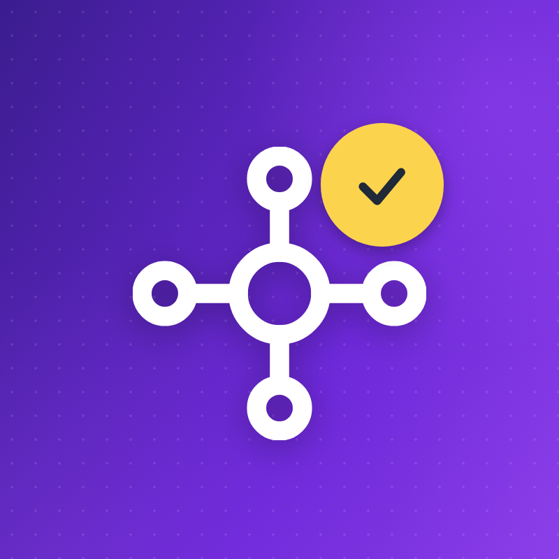
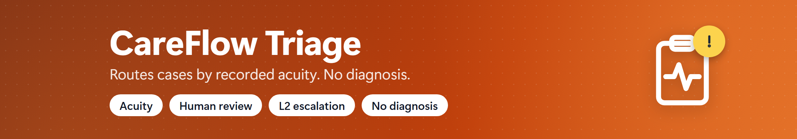
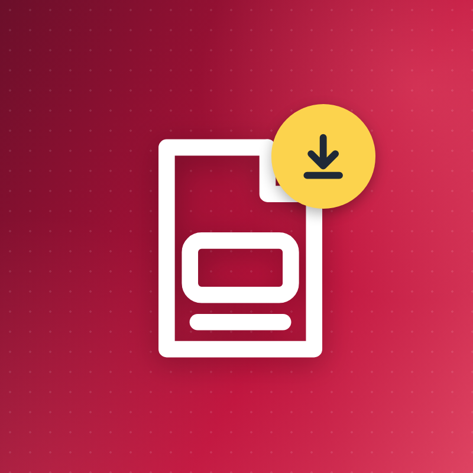

# CareFlow agents

The seven CareFlow agents, each with its Agentverse thumbnail (avatar) and banner (cover).
The image files are in [`assets/agents/`](assets/agents/).

| Avatar | Agent | Banner |
| :---: | --- | --- |
|  | **Supervisor** Port 8000 |  |
|  | **1 · EHR Search** Port 8001 |  |
|  | **2 · Math & Analytics** Port 8002 |  |
|  | **3 · Administrative Triage** Port 8003 |  |
|  | **4 · Document Generator** Port 8004 |  |
|  | **5 · Workspace Sync** Port 8005 |  |
|  | **6 · Compliance & Audit** Port 8006 |  |

Sizes: avatars are 800 × 800 px, banners are 2400 × 420 px (PNG).
